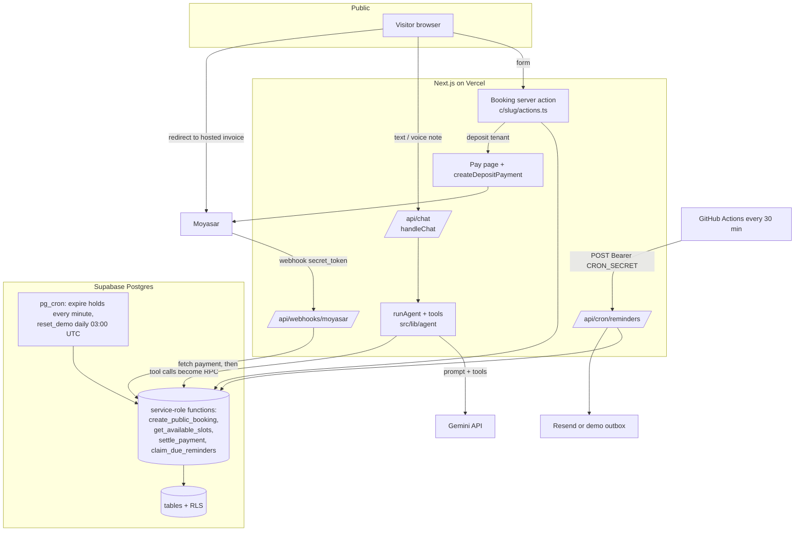

# Dawrak architecture

Everything below was checked against the code and migrations. Paths are relative to the repository root. Statements that could not be confirmed are marked (unverified).

## Main flows

1. **Public booking.** The booking page calls a server action (`src/app/[locale]/c/[slug]/actions.ts`) that, after a rate-limit check, calls the service-role function `create_public_booking`. If the business takes a deposit, the appointment is `pending_payment` with a 15-minute hold and the visitor is sent to a payment page.
2. **Chat assistant.** `/api/chat` (`src/lib/agent/chat-handler.ts`) runs: IP limit, parse the request through the channel adapter, resolve the business by slug, per-business daily limit, extra limits for voice notes, load or create the conversation, store the user turn, run the model with tools, stream the reply, store the assistant text. Tool calls become RPC calls to the same Postgres functions as the booking page.
3. **Payments.** `createDepositPayment` (`src/lib/payments/booking.ts`) inserts a pending payment with an unguessable token and creates a Moyasar invoice. Moyasar calls `/api/webhooks/moyasar`; the handler authenticates, fetches the payment from Moyasar's API and calls `settle_payment` (see below).
4. **Reminders.** A trigger on `appointments` creates the 24h and 2h reminders. `/api/cron/reminders` is called every 30 minutes by `.github/workflows/reminders.yml` and once a day by the Vercel cron in `vercel.json`. It first calls `expire_pending_bookings`, then claims due reminders (`claim_due_reminders`, `FOR UPDATE SKIP LOCKED`), sends them and records the result (`complete_reminder`: sent, skipped, failed, or retry with backoff 5, 15, 45 minutes... capped at 6 hours, at most 4 attempts, `src/lib/reminders/policy.ts`).
5. **Demo reset.** `reset_demo()` deletes every demo tenant and the demo outbox and calls `seed_demo()`. It is scheduled with pg_cron at 03:00 UTC (`20261113000014_demo_cap_flag_and_cron.sql`) if pg_cron can be enabled. The reminders endpoint also purges demo outbox rows older than 24 hours.

## Multi-tenancy and row-level security

- Every business table has `tenant_id`. Child tables use composite foreign keys `(id, tenant_id)` so a row cannot point at another tenant's parent (`20261113000002_core_tables.sql`).
- Roles live in `memberships(user_id, tenant_id, role)` with roles `owner`, `receptionist`, `provider`. Two `SECURITY DEFINER` helpers, `auth_tenant_role(tenant)` and `auth_provider_id(tenant)`, read memberships without recursion; both set `search_path = ''` (`20261113000005_rls.sql`).
- RLS is enabled and forced on all tables. The `anon` role has no table access at all; the public booking surface is a set of narrow functions.
- Policies after the least-privilege migration (`20261113000013_least_privilege_grants.sql`): catalogue tables (providers, services, hours, time off) are written by the owner only; appointments are updated by staff through `staff_update_appointment` (column grant only on `status` and `notes` for direct updates; a provider can only move own rows between confirmed, completed and no_show); payments are readable by the owner through 11 granted columns only (no `public_token`, `checkout_url`, `raw`); `customers.access_token` is not selectable by staff; conversations, messages and reminders are read-only for staff.
- **Service-role-only functions** (`20261113000010_security_hardening.sql`): `create_public_booking`, `get_available_slots`, `customer_*`, `issue_customer_magic_link`, `check_rate_limit`, `expire_pending_bookings`, `seed_demo`, `reset_demo`, `settle_payment`, `claim_due_reminders`, `complete_reminder`, the demo outbox functions and the portal functions. Reason: these functions are `SECURITY DEFINER` and must not be callable directly through `/rest/v1/rpc` by anyone, because the Next.js server applies `check_rate_limit` before calling them. Making them service-role-only closes that bypass. New functions are private by default (default privileges are revoked).
- Anonymous-callable: `public_get_tenant`, `public_list_services`, `public_list_providers` only.
- The Next.js server talks to the database as `authenticated` (dashboard, via the user's session) or as `service_role` (everything else). The service-role client is `src/lib/db/client.ts` and is marked `server-only`.
- Customers have no account. A customer holds a random 48-hex-character token (`customers.access_token`, expires after 30 days, rotated by every new link) in a magic link.

## Double-booking protection

Two layers, both in the database.

1. **Exclusion constraint** `appointments_no_overlap` (`20261113000003_booking_tables.sql`): a GiST constraint on `provider_id` and `tstzrange(starts_at, ends_at)` for rows with status `pending_payment`, `confirmed` or `completed`. It needs the `btree_gist` extension. This is the final guarantee: two overlapping rows cannot exist.
2. **Per-provider advisory lock** (`20261113000016_provider_locks_and_settle.sql`). Without it, two concurrent inserts for the same slot could end in a deadlock (SQLSTATE 40P01) instead of a clean `slot_taken`. `_lock_provider` takes `pg_advisory_xact_lock` on a hash of the provider id at the start of `create_public_booking`, `customer_reschedule_appointment`, `staff_update_appointment` (two providers are locked in sorted order) and `settle_payment`. Lock order everywhere: provider lock, then customer or payment row, then appointment rows. `expire_pending_bookings` uses `SKIP LOCKED` so it never waits.

Expired unpaid holds do not block a slot (`_slot_is_free` ignores them), so correctness does not depend on the cron schedule. `scripts/race-test.mjs` checks, against a local stack, that two concurrent bookings for one slot give exactly one success and one `slot_taken`. The author did not run it as part of this documentation task.

Other booking rules in `create_public_booking`: at most 3 active future appointments per phone per business, at most 90 days ahead, phone and name validation, and an existing customer (same business and phone) is never modified and its token is never returned.

## Agent design

- **Channel-agnostic core** (`src/lib/agent/run-agent.ts`): input is a plain message (text, or audio bytes plus media type), a tenant id fixed by the caller, a conversation id, the locale and history; output is a streamed reply. Channels live in `src/lib/channels/` behind a `ChannelAdapter` interface. The web adapter is wired; the WhatsApp adapter is a stub with a wiring plan and is imported by no route.
- **API key pool** (`src/lib/agent/key-pool.ts`): `GOOGLE_GENERATIVE_AI_API_KEYS` (comma-separated; the legacy single `GOOGLE_GENERATIVE_AI_API_KEY` is still honoured). `withKeyFailover` tries each available key once per model (round-robin start, in-memory per-key cooldowns: ~60 s per-minute quota, up to 1 h daily quota, 20 s on 503, 6 h invalid key) before the chain moves to the next model; embeddings use the same pool. Failover wraps only the model call (`doStream`/`doGenerate`/`embed`), which happens before the SDK runs a tool and never after a stream started, so the two-phase confirmation gate cannot be bypassed or a tool run twice. Keys travel in the `x-goog-api-key` header, errors are scrubbed and logs show only `#index`.
- **Model**: a fallback chain (`GEMINI_MODEL`, then `GEMINI_FALLBACK_MODELS`; `src/lib/agent/models.ts`, `fallback-model.ts`), default `gemini-3.5-flash-lite`, temperature 0.3, at most 700 output tokens, at most 8 steps (room for one retry after a rejected tool call), last 16 history messages. Tool inputs are validated tolerantly (`tool-input.ts`: null/empty optionals, times without seconds or offset read in the business timezone, `user_confirmed` true or the strings "true"/"yes") and then by the strict schema; a rejected call goes back to the model as a value-free, field-level error in the same turn.
- **Tools** (`src/lib/agent/tools.ts`): `check_availability` (max 14 days, max 12 slots, returned as business-local `date` and `time`), `prepare_booking` / `create_booking`, `prepare_reschedule` / `reschedule_booking`, `prepare_cancel` / `cancel_booking`, `get_my_appointments`, `search_knowledge`. `list_services` and `list_providers` are gone: the catalog is in the prompt. All input schemas are `z.strictObject`, so a model-supplied `tenant_id` fails validation. Tenant and conversation ids come from a closure. The model speaks `date` (YYYY-MM-DD) and `time` (HH:mm, 24 h) in the BUSINESS timezone and the server converts them with `zonedToUtc` (`local-time.ts`); an offset-carrying `starts_at` is no longer accepted, and a wall-clock time that does not exist (DST gap) is refused.
- **Confirmation protocol (server-enforced, not a prompt rule)**. Every mutating tool is two-phase and the token is bound to what the VISITOR saw, not to what the model sends. `prepare_*` validates (slot via `get_available_slots`, ownership, tenant, deposit availability), changes nothing, stores a pending record in `chat_agent_state` (the summary, the exact trimmed values shown in it, the token and its id) and returns a server-built summary (service, provider, local date and Hijri date, price, deposit state, canonicalised name and phone) plus a `confirmation_token`: an HMAC-SHA256 over {tenant, conversation, action, hash of the arguments, issued_at, expiry 15 min, number of visitor messages at issue, random id}. The key is HKDF-SHA256 (label `dawrak-chat-confirmation-v1`) over `CHAT_CONFIRM_SECRET` when it has 32+ characters, else over `SUPABASE_SERVICE_ROLE_KEY`; never logged. The token is NOT part of any tool output (those stream to the browser); the server hands it to the model, in the CONVERSATION STATE block, only in the turn whose visitor message confirmed the summary, and token-shaped strings in model text are redacted before storage. The widget renders the tool output's `summary_text` verbatim as a card, and the Confirm / Change buttons exist only together with that card; the same summary is stored as the start of the assistant message, so history and the dashboard show what was presented. The mutating tools (`create_booking`, `reschedule_booking`, `cancel_booking`) take ONLY `confirmation_token`: any other business field a model still sends (and `user_confirmed`) is dropped, a spoofed `tenant_id` is rejected, and the action executes the STORED pending values. They run only when ALL hold: there is a pending record of that action and the token is ITS token (a token of an older summary is stale); signature, tenant, conversation, action and expiry check out; the visitor-message count is exactly the one after the count at issue (so prepare and execute never share a turn and a late confirmation is stale); the visitor's LATEST message, read by the server, is typed text that `isAffirmative(text, locale, action)` accepts; the token is unused. A pending record is DELIVERED only after the assistant message carrying its summary was persisted (`delivered_message_id`, written in the stream's end handler) and only counts if the confirming visitor message was stored after that assistant message (both `created_at` come from the database clock): a request that overlaps the one still streaming the summary finds it undelivered and drops it. `chat_agent_state` writes are compare-and-set on a `version` column (migration 26); a lost race fails closed (pending treated as absent, prepare reports the conversation as busy). A stored message carries the summary only if it is still the pending one at the end of the turn, and model text next to it that names a clock time or a price the summary does not contain is replaced by a fixed neutral sentence. Before each turn `runAgent` clears the pending record unless the record is delivered and the latest visitor message is such an affirmative, and only then does the prompt tell the model to execute (with the token only). Any failed prepare or newer prepare clears or replaces it. Single use is a row in `chat_confirmation_uses` (primary key `(conversation_id, jti)`, migration 24) inserted BEFORE acting: concurrent executes race on the unique key and exactly one wins (proved against real Postgres in `tests/agent/confirmation-db.test.ts`); a failed action releases its row, a success marks the pending record done. Migration 25 deletes both tables' rows after 7 days (pg_cron plus the reminders cron route). A voice note is never a confirmation (the tool error tells the model to ask the visitor to tap Confirm or type it). `isAffirmative` is an action-aware whitelist: short message, every word an affirmative or polite filler; a message needs a strong word (تأكيد، أكد، نعم، ايوه، احجز، yes، confirm، book) or an acknowledgement (تمام، ok، موافق...) that stands alone or with polite words; cancellation words count only for a cancellation, and booking words (احجز، الحجز، الموعد، book, booking, appointment) are unknown words next to a cancellation, so only an explicit cancel phrase or the plain Confirm / تأكيد confirms it; emoji other than a plain thumbs-up or check, combining marks and a word repeated more than twice never confirm; negations, hedges, conditionals, questions and any new information are not confirmations. Rejections tell the model to ask the visitor to confirm the summary first, never to report a technical problem.
- **Grounding of personal data** (`grounding.ts`): name, phone and email must appear in the visitor's own TYPED messages of this conversation: the phone must equal a WHOLE digit run (after removing dates and times) in canonical form, so +966 / 00966 / 05 / Arabic digits match but no substring of a longer number or date does; the name's words must all appear as whole words in ONE message (not a prefix, not command words like Book Now); the email must appear as its own token. Placeholder addresses (example.com/net/org and look-alikes such as exampIe.com, test.com, domain.com, .invalid/.test/.localhost, no-reply, noemail, test@) are dropped as not provided; real addresses such as test+1@gmail.com or info@x.sa are kept. What is stored and shown is the canonical form (name punctuation cleaned, Saudi mobiles as +9665XXXXXXXX). Voice notes cannot ground values: the visitor must type them. Checked at prepare and again at execution.
- **Catalog in the prompt** (`catalog.ts`): services (ids, duration, price, deposit), providers (ids, which services) and weekly local hours, built per request, cached about 60 s per tenant and locale, sanitised and capped (30 services, 15 providers, 5000 characters) and delimited as DATA. A typical booking is `check_availability`, `prepare_booking`, `create_booking`. `chat_agent_state` (migration 24, service role only) keeps the last availability and the pending confirmation (incl. its token) so the next turn's system prompt carries them (`state.ts`) without persisting tool results as visitor-facing messages.
- **Hybrid knowledge search** (`hybrid-search.ts`): semantic (similarity at least 0.45) and lexical run together whenever any chunk of the tenant has no embedding, the best semantic score is under 0.6, or semantic returned nothing; results are merged with reciprocal rank fusion, deduplicated and marked `semantic`, `lexical` or `both`.
- **Customer identity in chat**: `create_public_booking` returns a token only when it created the customer. Only then is the conversation bound to that customer; the token never goes to the model. A returning phone number is not bound, so cancelling or moving that booking in chat is refused and the model is told to send the customer to the business. This prevents someone from managing another person's bookings by typing their phone number.
- **Rate limits** (`src/lib/agent/rate-limit.ts`, backed by `check_rate_limit`, fail closed): 20 messages per 10 minutes per IP; 300 per day per business; voice notes 6 per 10 minutes per IP and 60 per day per business. Voice limits: 25 s recording, 900,000 bytes decoded for WAV, 500,000 bytes for other containers (`src/lib/audio/limits.ts`).
- **Prompt-injection stance**: text from the user, tool results and the knowledge base is declared data in the system prompt; `search_knowledge` returns `untrusted_data: true`, drops chunks with similarity below 0.3 and truncates each chunk to 1200 characters; the model never sees internal ids of tokens; it takes no card details. These are mitigations. They do not make injection impossible, and no adversarial test against a real model was run (unverified). The real protection is that the tools can only do what a customer could do on the booking page, scoped to one tenant.
- **Storage**: user and assistant text is stored in `messages`; for voice turns only a label and metadata are stored. Tool calls are not stored as messages (`saveMessage` is only called for user and assistant text).

## Payment provider interface

`src/lib/payments/types.ts` defines `PaymentProvider` with `createCheckout`, `verifyAndParseWebhook` and `fetchPayment`. Money is integer minor units. Implementations: `moyasar.ts` (Invoices API, HTTP Basic with the secret key) and `fake.ts` (no network).

- `resolveProvider` picks Moyasar when `MOYASAR_SECRET_KEY` is set. The fake provider is never chosen implicitly; it needs `PAYMENT_PROVIDER=fake`, is refused on a Vercel production deployment, needs `ALLOW_FAKE_PAYMENTS=true` in any other production build, and `providerForTenant` allows it for demo businesses only.
- Moyasar has no HMAC signature in its webhooks per its docs (as read by the code author), so authenticity is a constant-time check of the `secret_token` in the body. The handler authenticates first, then ignores the amount and status in the event and fetches the payment from Moyasar's API.
- `settle_payment` (service role) is the only place that marks a payment paid and confirms the appointment. It is idempotent by `payment_events(provider, event_id)` and compares amount and currency with the stored row. Outcomes: `confirmed`, `confirmed_after_expiry` (hold lapsed but slot still free), `refund_due` (slot gone, or the appointment was cancelled on purpose, or amount mismatch), `already_paid`, `failed`, `duplicate`, `not_found`. `appointments.cancel_reason` (`payment_expired`, `customer`, `staff`) lets it revive only a lapsed hold.
- Deposit amount is computed in `src/lib/payments/deposit.ts` (fixed or percent, never above the price).
- Nothing was run against the real Moyasar API (unverified).

## Mail

`src/lib/mail/select.ts`: demo businesses always use the database outbox (`demo_outbox`, keyed by the SHA-256 of an httpOnly cookie, capped at 20 rows per visitor and 2000 in total, purged after 24 hours). Other businesses use Resend only if `MAIL_PROVIDER=resend` and a key are set; otherwise sending fails and reminders retry then fail.

## Demo protection

Triggers freeze identity fields of demo tenants and memberships for signed-in users, cap rows per demo tenant (for example 300 customers, 150 active future appointments, 20 knowledge documents, 200 chunks), and the seeding flag `dawrak.seeding` exempts only `seed_demo` and `reset_demo`. Length limits apply to free-text columns of all tenants.

### Per-visitor demo users (round 3)

The hosted demo has no shared login. `src/lib/auth/actions.ts#enterDemo` creates a temporary auth user per visitor through the Auth Admin API (service role): `app_metadata.demo_visitor = true`, `email_confirm`, a random address on `demo.dawrak.invalid` and a random 32-byte password that exists only inside that request. The server signs in with it (the SSR client sets the cookies), then calls `register_demo_user(user, tenant, role)` (owner or receptionist only), which records the visitor in `demo_users` (24-hour expiry; caps 300 total, 150 per tenant) and creates the membership. Any failure deletes the created user (`src/lib/demo/visitor.ts`). Expired visitors are removed by pg_cron (`purge_expired_demo_users()`, every 15 minutes) and, as a backup that does not need SQL access to `auth.users`, by `/api/cron/reminders` through the Admin API (`src/lib/demo/purge.ts`). A visitor's own GoTrue actions (password change, global logout) only touch their own account. The six fixed seeded users keep guard triggers (migration 19) and get random passwords on hosted resets.

The demo business is read-mostly (migration 22): authenticated demo users cannot update or delete seeded services, providers, provider links, hours, time off or knowledge rows; only rows with `created_by = auth.uid()` change. The dashboard mirrors this (`src/lib/dashboard/demo-lock.ts`, a banner and disabled controls); the trigger is the real gate and its `demo_readonly` / `demo_limit` / 23514 errors map to localized messages.

Demo customer links (migration 20): in demo tenants `customer_issue_link` only issues a link to the visitor session (`p_session_hash`, SHA-256 of the httpOnly cookie) that created the customer; valid tokens are reused, not rotated. `sendLinkEmail` resolves the mail provider before calling the RPC, so a patient's link is never touched when nothing can be sent.

Other round-3 app changes: auth cookies are HttpOnly, SameSite=Lax, Secure in production (`src/lib/auth/cookie-options.ts`, used by the server client and the proxy); voice notes accept WAV only; a per-phone booking cap of 3 per day (`book-phone:<tenant>:<sha256(phone)>`) on the web form and the chat tool; `/[locale]/boom` is a 404 unless `ALLOW_E2E_MOCKS=true`; payment pages send no-referrer, no-store and noindex; `TRUSTED_PROXY_HEADER` (right-most entry) is the only way off Vercel to get a per-client rate-limit bucket.

Unverified on a hosted Supabase project: `.invalid` addresses through hosted GoTrue, Admin API throughput on the free tier, SQL deletion from `auth.users` by pg_cron, creation of the `auth`-schema triggers by `db push`.

## Security review history

Two review rounds are recorded in the migration headers and the pgTAP tests. The finding labels are the ones used in those files. The original reports are not in the repository, so the description below is reconstructed from the code and tests.

**Round 1** (`20261113000010_security_hardening.sql`, tests in `dawrak_security.test.sql`), findings C1, H1 to H3, M1 to M3, L1 to L3:
- C1: `create_public_booking` could modify an existing customer or return its token. Fixed: create-if-absent only; the token is returned only for a customer created by that call; `issue_customer_magic_link` rotates the token and the app emails it to the contact on file.
- H1: sensitive booking functions were callable by anon. Fixed: service-role only, rate limit applied by the server; at most 3 active future bookings per phone.
- H2: owners could edit tenant identity and flags. Fixed with a column-level grant; the demo seed became self-healing.
- H3: providers and staff could edit appointments broadly. Fixed: provider limited to marking own rows completed or no_show; structural staff edits go through `staff_update_appointment`.
- M1: tokens never expired and staff could read them. Fixed: 30-day expiry, column grants exclude `access_token`.
- M2: unpaid holds were never released. Fixed: expiry function, pg_cron every minute, expired holds ignored by availability.
- M3: demo abuse. Fixed: knowledge base caps, memberships frozen for demo. The note to disable signups on the hosted project remains a manual dashboard step.
- L1 to L3: new functions private by default, `search_path = ''` on core functions, no truncate/trigger/references for `authenticated`.

**Round 2** (tests in `dawrak_hardening.test.sql`, migrations 11 to 16):
- H1 (grants audit): `payments` and other tables had broader grants than the dashboard needed. Fixed in `20261113000013_least_privilege_grants.sql` with column-level grants and removal of write policies on payments.
- M2: demo row caps did not apply to public bookings because the definer function ran as `postgres` and was exempt. Fixed with a transaction-local seeding flag instead of a role exemption (`20261113000014`).
- L1: a late payment could revive an appointment that a customer or staff had cancelled. Fixed with `cancel_reason` and `settle_payment` (`20261113000015`, `16`): such payments become `refund_due`.
- Race: concurrent bookings could deadlock instead of returning `slot_taken`. Fixed with provider advisory locks (`20261113000016`).

**Stayed unfixed or unproven**
- Disabling public sign-ups, enabling pg_cron and the hosted settings are manual and were not checked on a hosted project (unverified).
- CSP keeps `'unsafe-inline'` for scripts (reason in `src/lib/security/headers.ts`).
- Refunds are not automated; `refund_due` needs a person.
- Prompt injection is mitigated by design, not proven absent; the confirmation flag is model-asserted.
- Moyasar webhooks use a shared secret in the body rather than a signature, because the provider documents no signature.
- IP-based rate limits depend on the hosting platform's forwarded-IP header (`src/lib/db/client-ip.ts`); behaviour behind other proxies was not reviewed (unverified).
- A third review has not been done; the second round was not followed by an independent re-test (unverified).
